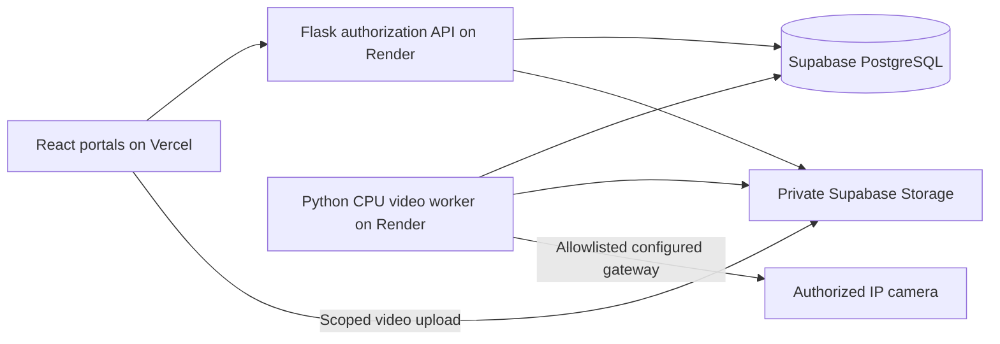

# Architecture

The retained React single-page application is deployed as static assets. The
API origin comes from REACT_APP_API_BASE_URL in every environment. No browser
Supabase client remains. Backend and worker use the same private database and
object bucket. A local SQLite/file mode is deliberately separate from production.

## Data and transitions

The casebook/overview are projections over these same canonical tables. They do
not maintain a second memo or analytics database. `tv_vehicle_profiles` stores
display details; approved `tv_ownership` remains the authority for access.
`tv_dataset_assets` holds checksummed source provenance/annotations and
`tv_case_metadata` explicitly marks fictional demonstration associations.
Government serialization redacts plates, owner profiles, private images, reviewer
details and raw observations. Date filtering uses UTC bounds; daily charts group IST.

For a prepared local build, `scripts.local_server` serves React static assets,
the authorized API, and one worker thread in a single stoppable process. Production
keeps API and worker as separate persistent services. Local startup reuses the
signing secret/database, so ordinary restarts preserve accounts and records.

`tv_candidates` contains observations, model/rule/calibration versions, raw OCR,
source-relative time, processing UTC, private checksummed references and review
state. `PENDING ↔ NEEDS_EVIDENCE → CONFIRMED or REJECTED` is enforced by the API.
Confirmation requires an image and explicit evidence acknowledgement. It creates
one separate violation and one project memo in the same transaction. Unknown
plates/owners remain reviewable; owner dispatch is blocked until a verified link
exists at issue time. No guessed vehicle/owner is generated.

Memo transitions: `UNPAID → SANDBOX_PAID`, or `UNPAID → DISPUTED → VOID/UNPAID`.
A unique payment row per memo makes retries idempotent. No real payment provider
is connected. Existing unsubstantiated PAID records import as LEGACY_UNVERIFIED.
Only approved ownership links expose citizen records. Pending and rejected links
give no evidence/fine/contact access. A single plate may have one approved owner;
ownership transfers require a separate documented administrative process.

Project fine policy = base × eligible confirmed offence count², capped at INR
1,000,000. Confirmations lock the candidate and acquire a PostgreSQL advisory lock
for plate/type before counting; SQLite serializes write transactions. Voided
memos do not count for future issues; prior issued amounts are not recalculated.
No licence cancellation action exists. Policy versions and overrides are audited.

## Identity

Passwords use Werkzeug scrypt. Thirty-minute bearer JWTs are kept in sessionStorage
and revalidated against `/api/auth/me`; stored roles are never authoritative.
Each authorized request checks the database role, active flag and token version.
Logout records JTI revocation; role/password changes revoke existing sessions.
Password change requires the current password. Self-service reset is honestly
unavailable; a trusted terminal recovery command follows an identity check.
This is one identity system, independent of Supabase Auth. Bearer tokens are not
ambient cookies, so cookie CSRF is not used. CORS permits exact configured origins.

## Queue and media

PostgreSQL is the durable queue at this scale; no second Redis service is needed.
Jobs use `FOR UPDATE SKIP LOCKED`, 45-second renewable leases and three bounded
attempts for interrupted workers. Cancellation is checked between bounded batches.
Video retries replay from zero to reconstruct deterministic track IDs; stable
session/track/rule event keys prevent duplicate candidates. Candidate and memo
uniqueness constraints additionally protect retries and concurrent review clicks.

One worker is the supported configuration. Do not scale multiple workers against
the same webcam session without adding per-session claim locking. One CPU worker
can process one upload/IP job at a time, so long IP sessions delay other work.
Webcam input defaults to 1 FPS and max 1280px/512 KiB JPEG. Each source has at most
one processing and one replaceable queued frame. Sequences/timestamps reject replay;
frames older than five seconds drop. In-flight client requests are bounded to one.
The preview displays the exact annotated frame, separately from fresher live video.
Inference FPS/latency and drops are measured, never simulated.

Uploads are limited to 100 MiB, 10 minutes, 4096px and 72,000 decoded frames; only
timestamped supported codecs proceed. Sampling uses decoded PTS at approximately
2 FPS because container FPS metadata can be misleading. Decoding and temp storage
run in the worker. Production uploads go directly to private storage through
scoped authorization, never through Vercel Functions. Supabase upload token lifetime
is provider-defined (currently two hours); local tickets expire after ten minutes.
Private source downloads are operator-only and production links expire after 60s.

IP sources are exact environment-provisioned keys; users cannot submit arbitrary
URLs. Use an authorized gateway with fixed destinations and host egress restrictions.
Camera credentials are never returned. The capture thread has one latest-frame
slot. Failure is visible; restart explicitly after restoring the gateway. Sessions
are capped at 15 minutes. Webcam inactivity expires after 30 seconds. Camera version
changes stop affected sessions; resolution mismatch fails processing. A physical
viewpoint/crop change must be declared by the operator and recalibrated.

## Evidence and limits

Timestamped JPEG snapshots plus optional uncertain OCR crops are private and
checksummed. Pre/post-event video clips are not generated; the retained uploaded
original provides operator context. Browser images go through an authorized API.
Evidence audit rows retain original observations/corrections; source time is distinct
from UTC processing time. Uploaded absolute capture time is unknown and labeled.
UI timestamps use Asia/Kolkata; analytics dates use explicit UTC filter bounds.

Ten queued/active upload jobs and four active live sessions bound the queue.
Provider bucket object-size limits and configured storage quotas must be monitored.
Local private storage has a conservative 5 GiB cap by default (MAX_LOCAL_STORAGE_BYTES).
Run `python -m backend.manage retention --days 30` on a scheduled operator task;
it removes old objects and marks missing evidence while retaining audit/memo rows.
There is no legal hold or automated storage-budget scheduler in this build.

Track-level duplicate suppression does not prove cross-session identity through
occlusion/reconnects. Related camera/rule candidates are shown for reviewer checks;
reviewers must reject repeated incidents. No arbitrary-camera accuracy claim is made.

Notifications default to PREVIEW. SMTP mode requires credentials and an exact
verified-recipient allowlist. Durable attempts/backoff persist across restarts.
SMTP has no transactional exactly-once guarantee: a crash after acceptance may retry
the same Message-ID. No real notices or charges are sent in tests.
