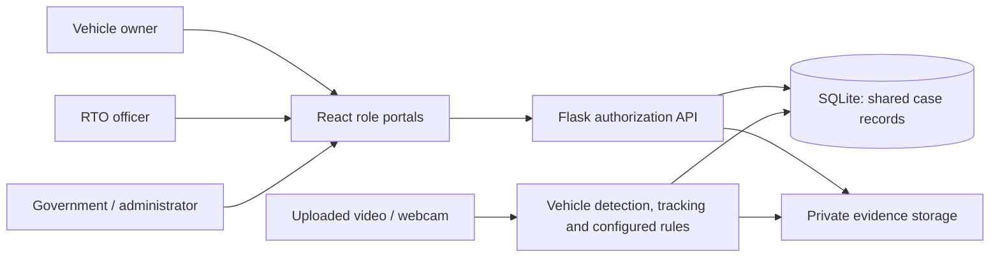
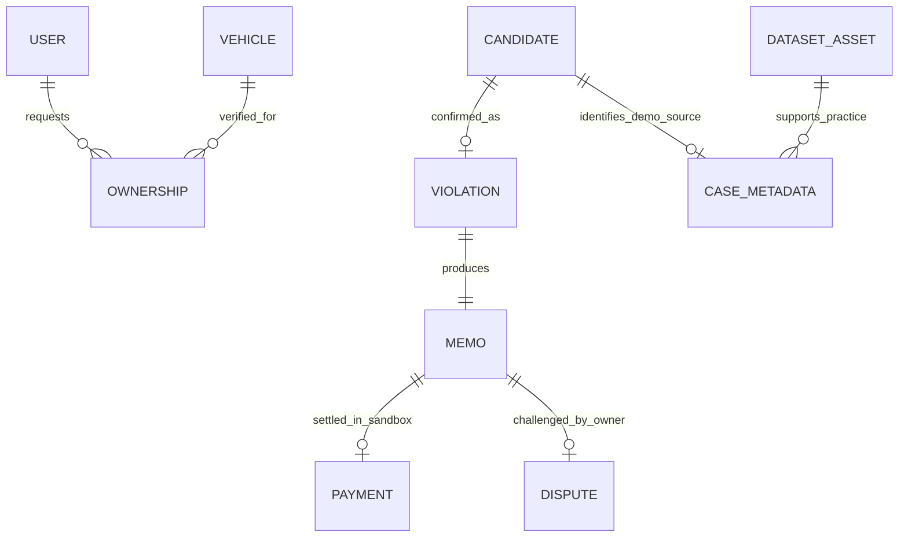

# AI-assisted Traffic Violation Review and e-Memo Management

## Abstract

This project connects traffic observations, evidence, RTO review, vehicle ownership,
project memos, citizen responses and government analytics in one application.
Video analysis detects and tracks vehicles and flags configured movement-rule
events. Officers can also submit manual observations or review attributed dataset
examples. An RTO officer verifies the evidence and registration before confirmation.
The confirmed case produces a memo that its verified owner can inspect, download,
pay in a sandbox, or dispute. Every role uses the same persisted database.

## Problem and objectives

Separate records make it difficult to explain why a memo exists, what evidence
supports it, who reviewed it and whether it was resolved. The project aims to:

1. Preserve the complete evidence-to-resolution history of a traffic case.
2. Assist reviewers with vehicle detection and configured movement observations.
3. Restrict citizen access to verified ownership links.
4. Demonstrate memo generation, payment receipts and dispute resolution safely.
5. Produce consistent oversight reports from actual saved records.

## Modules and users

| Role | Main responsibilities |
|---|---|
| Vehicle Owner | Register, request ownership verification, inspect own evidence/memos, record sandbox payments, submit disputes and download PDFs |
| RTO | Analyse video, add observations, review evidence, verify ownership, issue memos, resolve disputes and inspect notice previews |
| Government | View anonymized case summaries and filter aggregate trends, locations, violation types and memo totals |
| Administrator | Assign trusted roles, manage project fine policy, inspect service status and review audit history |

## Technology and architecture

The frontend uses React, React Router, Axios and Recharts. Flask provides the
authenticated API. SQLAlchemy manages the local SQLite database. A Python/OpenCV
worker loads the checksummed YOLOX model and performs detection, bounded tracking,
rule evaluation and evidence capture. Private media is accessed through authorized
API requests. A neural plate-reading adapter provides review suggestions when a
suitable readable plate is localized; uncertain results require manual correction.

The local launcher serves the React build on port 3001 and the API on 5000,
with one background video worker. It reuses the signing secret and saved database.
React is the only frontend framework. Optional hosted deployment files are
provided separately; public hosting is not required for this local college release.

## Main database relationships

| Table | Purpose and relationship |
|---|---|
| `tv_users` | Account identity, hashed password, current role and session version |
| `tv_vehicle_profiles` | Vehicle display details and explicitly fictional demo profiles |
| `tv_ownership` | User-to-plate verification requests and decisions |
| `tv_candidates` | Suspected events, evidence references, source time, plate observations and review state |
| `tv_violations` | Confirmed violation linked uniquely to its candidate |
| `tv_memos` | One project memo per confirmed violation, amount and resolution status |
| `tv_payments` | Sandbox receipt linked uniquely to a memo |
| `tv_disputes` | Citizen explanation, supporting evidence and RTO decision |
| `tv_cameras`, `tv_sessions`, `tv_jobs` | Camera setup and durable video-processing work |
| `tv_dataset_assets`, `tv_case_metadata` | Source attribution, image checksums and explicit demonstration markers |
| `tv_audit`, `tv_outbox` | Recorded actions and owner-notice previews |

Vehicle access is enforced using approved ownership links and the confirmed
violation's plate. A display profile alone never grants access.

## Case-processing workflow

1. A video event, manual observation or dataset exercise creates a candidate.
2. The RTO inspects its image, context, uncertain plate and vehicle-owner link.
3. The officer confirms, rejects or requests more evidence with a reason.
4. Confirmation saves the violation and memo in one transaction. Unique keys
   protect this transition from repeated submissions.
5. A verified owner downloads the memo and either records a sandbox payment or
   disputes an unpaid memo. A separate case can demonstrate the other path.
6. Upholding a dispute cancels the memo; dismissing it restores unpaid status.
7. The case timeline, receipt/status and government analytics reflect the same records.

## Video processing

The detector supports its actual vehicle/person classes; it does not invent
helmet or licence labels. The tracker associates observations over time. Movement
rules use configured zones, direction, source timestamps or measured distances.
Wrong-way, restricted-zone, stop-line, no-parking and speed checks require their
specific camera settings. Red-light checks additionally require a recent manual
signal observation. Unknown signals and missing speed calibration prevent the
corresponding rule from producing a valid event.

The interface supports the included prerecorded traffic clip, uploaded video and
a browser webcam. It displays the timestamped analysed frame, processing status
and flagged cases. Frames are sampled; the system is an aid to review rather than
an assurance that every event will be detected.

## Security and data integrity

Passwords are hashed. JWT sessions are checked against the current database role
and revocation/version state. Public registration creates citizens only. Evidence
and memos require role and ownership checks. Private file references have checksums.
Confirmation, payment and other important transitions are validated on the server.
Audit records preserve reviewer reasons. Government summaries redact identifiable
plates, owners, private images and raw observations. Secrets are excluded from Git.

## Demonstration data and ethical scope

The image library retains dataset source links, attribution, licences and published
annotations. Example vehicle/owner assignments are fictional and do not identify
anyone in the photographs. Dataset labels support manual exercises and are not
presented as predictions generated by this application.

Fine amounts use the project's versioned demonstration policy. No official challan
is issued, real money transferred or government ownership service accessed. Owner
notices remain saved previews. An administrator provides local account support.

## Testing and results

See `TEST_REPORT.md` for the executed counts and commands. Checks cover role and
ownership privacy, real inference through memo/payment, evidence, duplicate
protection, disputes, persistent registration, job replay/recovery, configured rule
boundaries, visible case-reference search, IST dates and consistent analytics.
Browser checks cover the complete role journey, responsive screens, webcam
permission/cleanup, uploads, the included video and the college interface choices.

Passing these checks establishes software behavior. It does not establish field
accuracy for every road/camera. The vehicle detector timing and plate/model limits
are retained in `MODEL_SETUP.md` with source/checksum information.

## Scope and future extensions

The submitted scope is AI-assisted review and e-Memo management. Automatic
helmet/triple-riding/seatbelt/phone-use enforcement, official registry connections,
real payment collection and external camera gateways are outside this release.
They can be discussed as future extensions without showing unfinished controls
in the college interface. Human review, sandbox payments and notice previews are
intentional completed features of this version.

## Viva talking points

- **What is automatic?** Vehicle detection/tracking and configured movement-rule flags.
- **Who issues the memo?** An authorized RTO confirmation creates it on the server.
- **Why human review?** Camera views, context and plate readability can be uncertain.
- **How is privacy enforced?** Current database roles and approved ownership links are
  checked for each protected operation; the browser cannot grant itself a role.
- **How are duplicates handled?** Database uniqueness/idempotency prevents repeated
  confirmation or payment from creating another memo or receipt.
- **Why SQLite?** It provides a persistent, self-contained local college demonstration.
- **Are payments real?** No; a sandbox receipt demonstrates the transaction workflow.
- **Are the example people identified?** No; all owner/registration associations are fictional.
- **What is the contribution?** Integrating evidence, review, ownership, memos, citizen
  responses and consistent oversight around an actual computer-vision pipeline.

Add the institution's required cover page, student/guide names and submission
formatting when preparing the final academic document.
